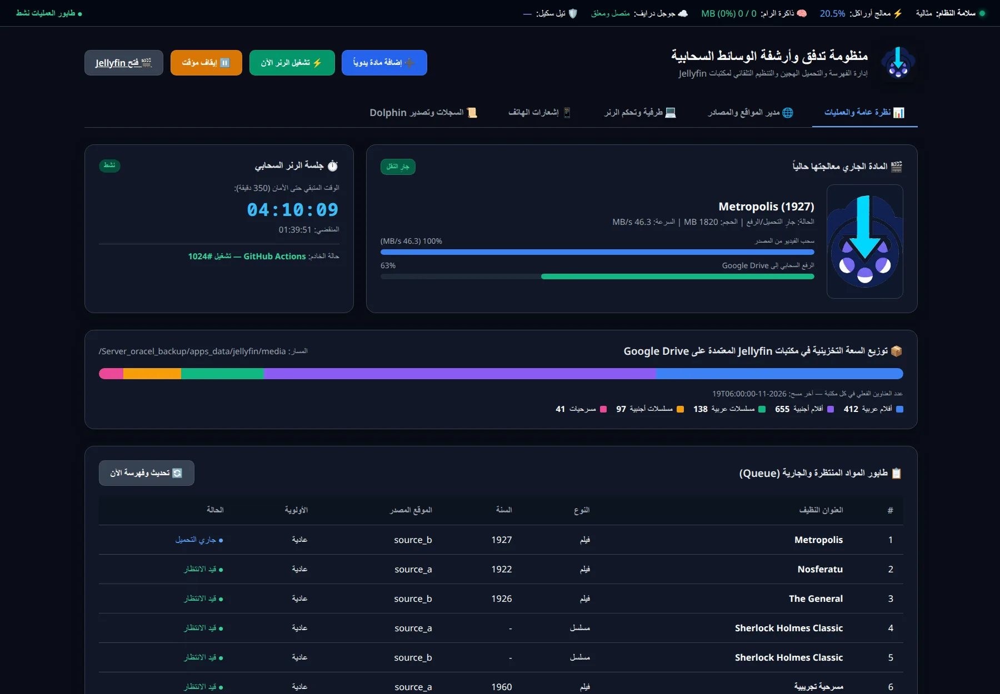
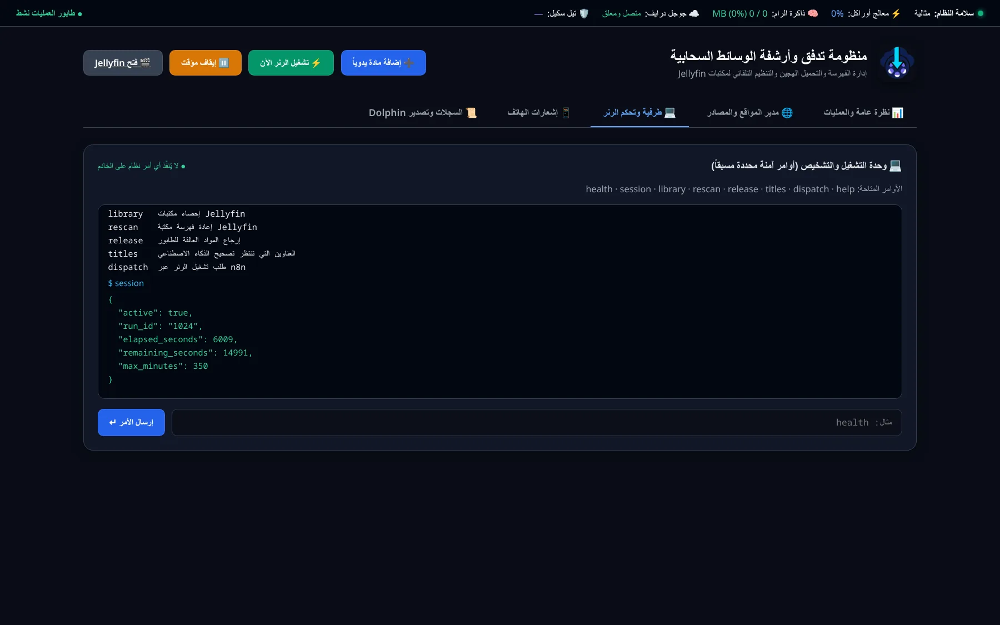
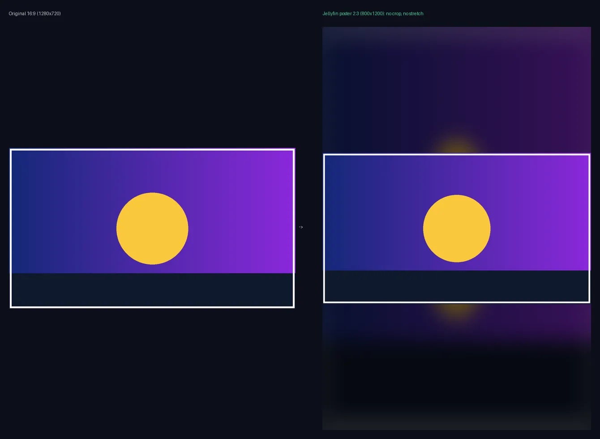
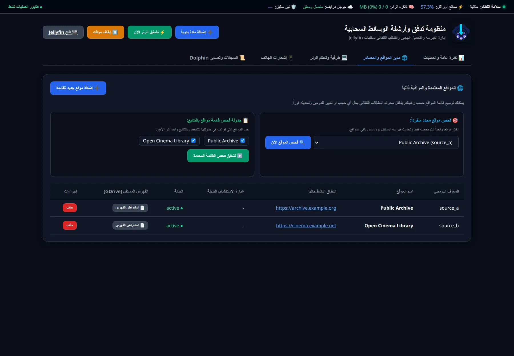
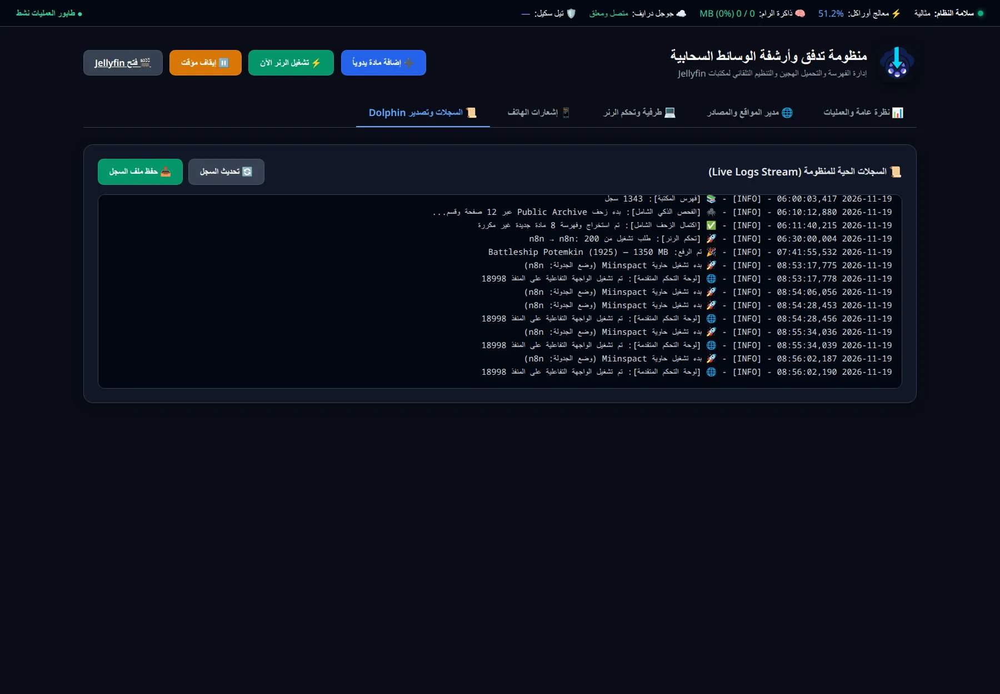

<div align="center">


# Miinspact Media Runner

**منظومة أرشفة وسائط هجينة: لوحة تحكم خفيفة على سيرفرك + رنر سحابي مؤقت يقوم بكل العمل الثقيل**

*A hybrid media-archiving pipeline: a featherweight controller on your own server, and an ephemeral cloud runner that does all the heavy lifting.*


</div>

---



## لماذا Miinspact؟

| المشكلة | الحل |
|---|---|
| السيرفر المنزلي أو المجاني ضعيف ولا يحتمل التحميل والمعالجة | التحميل والمعالجة والرفع تتم بالكامل على رنر سحابي مؤقت، والسيرفر يدير فقط |
| تكرار تحميل نفس الفيلم أو الحلقة | فهرس حي لمكتبة Jellyfin الفعلية: الفيلم الموجود يُتخطى، والحلقة أو الموسم الجديد فقط يُحمَّل |
| عناوين فوضوية ("مسلسل … الحلقة 6 السادسة مترجمة") | محلل عناوين عربي/إنجليزي + تصحيح بالذكاء الاصطناعي للحالات الصعبة فقط |
| أغلفة مقصوصة أو ممطوطة في Jellyfin | محرك أغلفة 2:3 يحافظ على الصورة كاملة، خفيف (≈100–200KB) وبتحميل تدريجي |
| جدولة عشوائية واستهلاك دقائق بلا فائدة | n8n يشغّل الرنر فقط عند وجود عمل وعدم وجود رنر آخر |

## كيف تعمل المنظومة

```
                    ┌──────────────── n8n (المنسّق) ────────────────┐
                    │  زحف يومي · تشغيل الرنر عند الحاجة · حارس الطابور │
                    └──────┬──────────────────────┬─────────────────┘
                           │                      │ workflow_dispatch
          ┌────────────────▼───────┐      ┌───────▼──────────────────────┐
          │  Controller (خاص)       │◄────►│  Media Runner (هذا المستودع)  │
          │  ≤0.5 vCPU · ≤512MB     │ API  │  GitHub Actions مؤقت          │
          │  فهرسة · طابور · لوحة    │ موثّق │  تحميل · غلاف 2:3 · رفع       │
          └────────────┬───────────┘      └───────┬──────────────────────┘
                       │ قراءة فقط                  │ rclone
                       ▼                          ▼
              مكتبة Jellyfin ◄──────────── التخزين السحابي (Google Drive)
```

1. **n8n** يطلب من الكنترولر إعادة فهرسة المكتبة ثم الزحف على المصادر المسجلة يومياً في وقت هادئ.
2. العناوين الملتبسة تُرسل دفعة واحدة لنموذج ذكاء اصطناعي (NVIDIA) ليعيدها بصيغة JSON صارمة.
3. كل 30 دقيقة: إذا وُجدت مواد في الطابور ولا يعمل رنر آخر، يُطلق **هذا الرنر**.
4. الرنر يسحب المهام عبر واجهة موثّقة، ثم يحمّل الملف ويتحقق منه بـ ffprobe، ويبني الغلاف ويرفع إلى المسار الصحيح في Jellyfin.
5. التقدم (نسبة التحميل والرفع والسرعة والوقت المتبقي للجلسة) يظهر حياً في اللوحة، ويصل إشعار للهاتف عند الاكتمال.

## المميزات

### 🖥️ لوحة تحكم حية
عداد جلسة حقيقي (350 دقيقة)، وشريطا تحميل ورفع من تقارير الرنر الفعلية، وتوزيع حقيقي لمحتوى كل مكتبة، وطابور كامل، ومدير مصادر، وإيقاف واستئناف، وإضافة يدوية برأس الطابور.



### 🛡️ آمن افتراضياً
- كل واجهات الـ API تتطلب رمز وصول، ولا توجد أي واجهة لتنفيذ أوامر نظام.
- حاوية الكنترولر تعمل بمستخدم غير root، بنظام ملفات للقراءة فقط، بلا صلاحيات (`cap_drop: ALL`)، مع حدود صارمة للمعالج والذاكرة والعمليات.
- الرنر في مستودع عام لكنه لا يعرف أي عنوان أو مسار؛ كلها أسرار مشفرة، والسجلات العامة تحتوي أرقام المهام فقط.

### 🖼️ محرك الأغلفة
يبحث عن أفضل صورة متاحة: صورة المصدر إن كانت بدقة كافية، ثم IMDb بعدة صيغ للعنوان، ثم ويكيبيديا. بعدها يطبّع الصورة إلى 2:3 دون قص أو مط، ويملأ الفراغ بخلفية ضبابية من الصورة نفسها، ويضغطها بتحميل تدريجي.



### 📚 بنية Jellyfin الرسمية
```
Movies/Arabic_Movies/Title (Year)/Title (Year).mp4 + poster.jpg
Series/Foreign_Series/Title/poster.jpg
Series/Foreign_Series/Title/Season 02/Title - S02E05.mp4
Plays/Title (Year)/Title (Year).mp4 + poster.jpg
```

| مدير المصادر | السجلات |
|---|---|
|  |  |

## إعداد الرنر (هذا المستودع)

أضف الأسرار التالية في **Settings → Secrets and variables → Actions**:

| السر | الوصف |
|---|---|
| `RUNNER_API_URL` | عنوان webhooks الخاص بـ n8n |
| `RUNNER_API_TOKEN` | رمز يتحقق منه n8n قبل تسليم أي مهمة |
| `RCLONE_CONFIG_BASE64` | قسم الريموت فقط من ملف rclone بترميز Base64 |
| `RCLONE_REMOTE` | اسم الريموت |
| `MEDIA_BASE_PATH` | جذر مكتبات Jellyfin داخل الريموت |

يُشغَّل الرنر عبر `workflow_dispatch` فقط (من n8n أو يدوياً)، وفي كل وقت رنر واحد (`concurrency`). يتوقف عن أخذ مهام جديدة قبل نهاية الجلسة بـ 25 دقيقة.

## الحزمة الكاملة

الكنترولر ولوحة التحكم وworkflows الـ n8n جزء من **الحزمة الخاصة** ولا تُنشر هنا. للاستفسار عن الحزمة الكاملة أو التركيب على سيرفرك، افتح [Issue](../../issues) بعنوان "Full bundle".

> المنظومة أداة أرشفة. المستخدم مسؤول عن أن تكون المصادر التي يضيفها مما يملك حق تنزيله وأرشفته.

---

<div align="center"><sub>Built with GitHub Actions · n8n · Jellyfin · rclone · yt-dlp · Pillow</sub></div>
